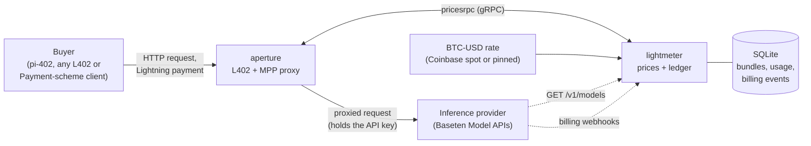
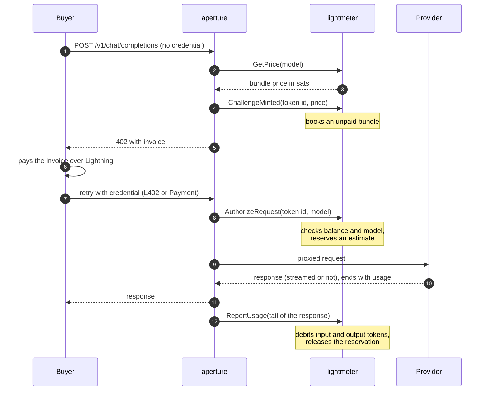

# lightmeter

lightmeter prices LLM tokens in satoshis and keeps the books for a seller of
paid inference. It runs next to an [aperture](https://github.com/lightninglabs/aperture)
proxy as that proxy's price server: aperture asks it what a request costs,
charges the buyer over Lightning, and reports back how many tokens the model
actually served. lightmeter turns the provider's USD price list into msat per
token, sells tokens in prepaid bundles, debits each bundle by what was really
used, and checks its ledger against the provider's own bill.

The name follows aperture's: the aperture controls what gets through, the light
meter decides the exposure.



## What it does

lightmeter does four jobs, and none of them belongs in a generic proxy:

- **Prices tokens.** Each model has an upstream USD price per million input
  tokens and per million output tokens. lightmeter adds your margin, converts
  at the BTC-USD rate, and rounds up to whole msat per token. The rounding
  always favors the seller, and any positive price floors at 1 msat.
- **Sells bundles.** One payment buys a bundle of tokens, one million by
  default, sized per model if you like. The buyer then draws it down across as
  many requests as the balance covers, with no payment round trip on each one.
- **Debits what was served.** After each response, aperture hands over the
  tail of the body and lightmeter reads the provider's `usage` object out of
  it. Input tokens are debited at the input rate and output tokens at the
  output rate, so your margin holds whatever the buyer's prompt to completion
  mix turns out to be.
- **Reconciles the books.** Every debit is a row in a SQLite ledger. An
  HMAC-verified webhook takes in the provider's billing events, and
  `GET /recon` compares the tokens you sold against the tokens you were billed
  for, per model.

The bundle mechanics themselves (booking a bundle when a challenge is minted,
reserving an estimate while a request is in flight, the debit) are not
reimplemented here. They live in aperture's `meterd` package, which lightmeter
embeds through its `Store` and `RateSource` interfaces. lightmeter supplies a
SQLite store and a live price table.

### One paid request, end to end



Later requests start at step 7 and skip the payment. When a bundle runs dry,
`AuthorizeRequest` answers with a quote for the next one and aperture mints a
fresh challenge.

### Payment schemes

aperture speaks both [L402](https://github.com/lightninglabs/L402) and the
[Payment HTTP Authentication Scheme](https://datatracker.ietf.org/doc/draft-httpauth-payment/)
(MPP), and lightmeter prices all three ways a buyer can pay:

| Buyer pays with | What one payment buys | Who holds the balance |
|---|---|---|
| L402 | a token bundle | lightmeter |
| MPP charge | a token bundle | lightmeter |
| MPP session | a deposit that requests draw against | aperture |

For sessions, aperture holds the deposit and asks lightmeter only to price
each request (`QuoteSession`) and to cost it once served (`SettleSession`).
Both use the same blended rate a bundle is priced at, so a session and a bundle
charge the same for the same work.

## Getting started

You need Go 1.25 or later. `grpcurl` is handy for poking at the daemon but not
required.

**1. Build.**

```bash
git clone git@github.com:lightninglabs/lightmeter.git
cd lightmeter
go build ./cmd/lightmeterd
```

**2. Write a config.** This is the smallest one that runs. It prices one
model, pins the BTC-USD rate so the numbers are predictable, and needs no API
key.

```yaml
# lightmeter.yaml
listenaddr: "127.0.0.1:10020"
dbpath: "lightmeter.db"
defaultmodel: "zai-org/GLM-4.7"
models:
  "zai-org/GLM-4.7":
    inputusdpermtok: 0.60
    outputusdpermtok: 2.20
pricing:
  marginpercent: 25
  btcusd:
    staticrate: 100000
```

**3. Run it.**

```bash
./lightmeterd --config lightmeter.yaml
```

```
INFO Rate table refreshed models=1 btc_usd=100000
[INF] METR: Prices server listening on 127.0.0.1:10020
INFO lightmeter running listen=127.0.0.1:10020 db=lightmeter.db
```

**4. Ask it for a price.** lightmeter has no gRPC reflection, so point
`grpcurl` at `prices.proto` in an aperture checkout:

```bash
grpcurl -plaintext -import-path ../aperture/pricesrpc -proto prices.proto \
  -d '{"path":"/v1/chat/completions","http_request_text":"POST /v1/chat/completions HTTP/1.1\r\nHost: x\r\n\r\n{\"model\":\"zai-org/GLM-4.7\"}"}' \
  127.0.0.1:10020 pricesrpc.Prices/GetPrice
```

```json
{
  "priceSats": "2000"
}
```

Here is where 2,000 comes from. With a 25% margin, $0.60 and $2.20 per
million tokens become $0.75 and $2.75. At $100,000 per BTC that is 0.75 and
2.75 msat per token, which round up to 1 and 3. A bundle is priced at the
average of the two, 2 msat per token, and a million of them is 2,000 sats.

**5. Put aperture in front of it.** In aperture's config, give the service a
`dynamicprice` block with `metered: true`. Without `metered`, aperture only
ever calls `GetPrice`, so nothing is debited.

```yaml
# aperture.yaml (the relevant service only)
services:
  - name: "inference"
    hostregexp: '^.*$'
    pathregexp: '^/v1/.*$'
    address: "inference.baseten.co:443"
    protocol: https
    headers:
      # aperture expands ${VAR} from its own environment, so the key stays
      # out of the file and never reaches the buyer.
      Authorization: "Bearer ${BASETEN_API_KEY}"
    dynamicprice:
      enabled: true
      grpcaddress: "127.0.0.1:10020"
      insecure: true
      metered: true
```

From here, a request to aperture with no credential gets a 402 whose invoice
is the bundle price above. For a full working stack with a buyer, a wallet and
a local chain, see the regtest profile in
[pi-402's `dev/demo`](https://github.com/lightninglabs/pi-402/tree/main/dev/demo).

**Going further.** [`lightmeter.sample.yaml`](lightmeter.sample.yaml) documents
every option. The ones you will reach for next:

- Set `pricing.btcusd.staticrate: 0` to follow Coinbase spot instead of a
  pinned rate.
- Set `baseten.apikeypath` to discover models from `/v1/models`. Discovered
  models sell at `pricing.defaultusd` rates; models you list in `models`
  always keep your prices.
- Set `bundletokens` on a model to size its bundle. An expensive model with a
  smaller bundle keeps the up-front payment in the same range as a cheap one.
- Set `webhook.listenaddr`, `webhook.secret` and `webhook.recontoken` to
  ingest billing events and turn on `GET /recon`.

## For agents

If you are an AI agent working in or with this repo, here is what you need.

**Build, vet, test:**

```bash
go build ./... && go vet ./... && go test ./...
go build -o lightmeterd ./cmd/lightmeterd
```

**Layout:**

| Path | What lives there |
|---|---|
| `lightmeter.go` | `Daemon` and `Main()`: builds the store and price table and hands both to `meterd.NewServer` |
| `config.go` | YAML plus flags. Nested settings (`models`, `pricing`, `webhook`) are YAML only. |
| `pricing/` | `Table` implements `meterd.RateSource`; `MsatPerToken` is the USD to msat conversion |
| `store/` | `SQLiteStore` implements `meterd.Store`, plus the usage ledger and `ReconReport` |
| `webhook/` | the HMAC webhook receiver and `GET /recon` |
| `cmd/lightmeterd/` | the binary |

**Rules that must hold:**

- Bundle booking, reservation and debit logic belongs in aperture's `meterd`.
  Change it there, never here.
- Rounding never favors the buyer. msat rates round up, and a positive USD
  price is never below 1 msat per token.
- A `RateSource` must fail to resolve a model it does not know. Falling back to
  a default would let a cheap bundle pay for an expensive model.
- `go.mod` must copy aperture's `replace` directives, since Go does not apply
  them transitively. After bumping aperture, diff the two.
- The gRPC listener trusts its caller completely (`ReportUsage` moves
  balances), so the daemon refuses plaintext on any address but loopback.

**Checking your work against a running daemon:** use the `grpcurl` call from
step 4. `GetPrice` exercises config loading, the price table and the
conversion; `QuoteSession` takes the same request shape and should return the
blended rate times the request's `max_tokens`.

## Docs

- [Architecture](docs/architecture.md): the whole system across pi-402,
  aperture and lightmeter, and the bundle lifecycle in detail.
- [Pricing](docs/pricing.md): the USD to msat pipeline, refresh behavior and
  bundle sizing.
- [Operations](docs/operations.md): deployment, the database, reconciliation
  and the failure modes worth alerting on.

## Status

The buyer side is [pi-402](https://github.com/lightninglabs/pi-402), a
[Pi](https://pi.dev) extension that pays these challenges from an embedded
Wavelength wallet. Webhook parsing is deliberately tolerant: billing event
schemas vary by provider, so every event is stored verbatim and the token
counts are pulled out on a best-effort basis.
