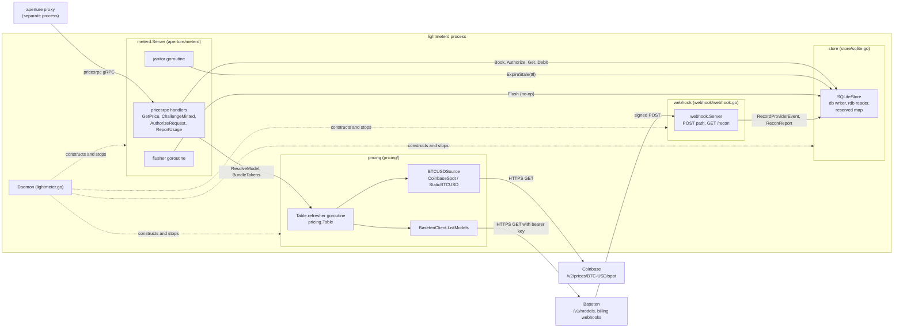
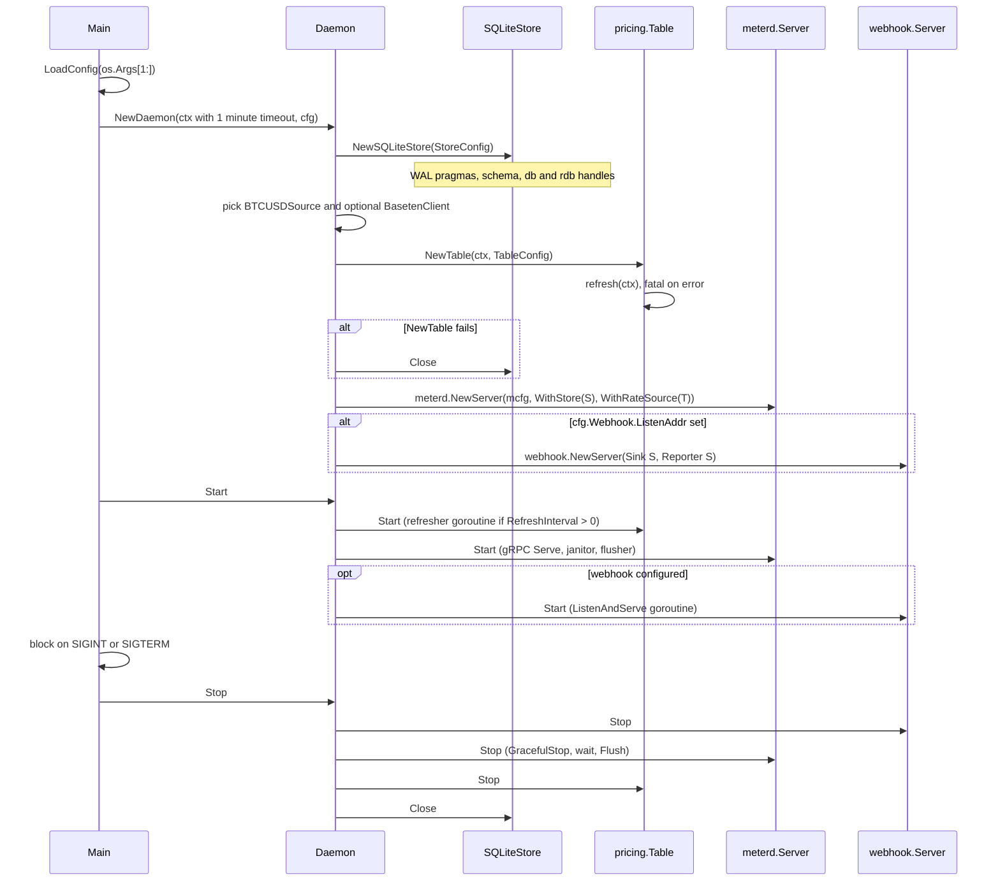
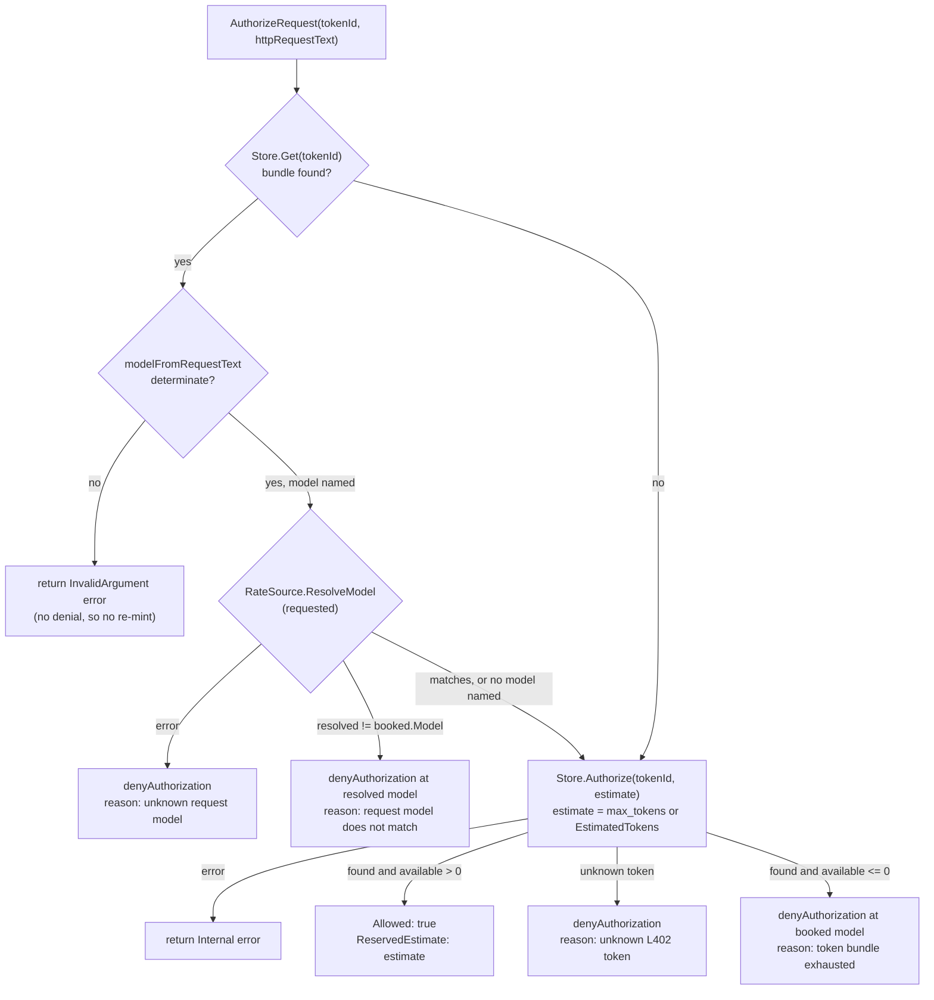
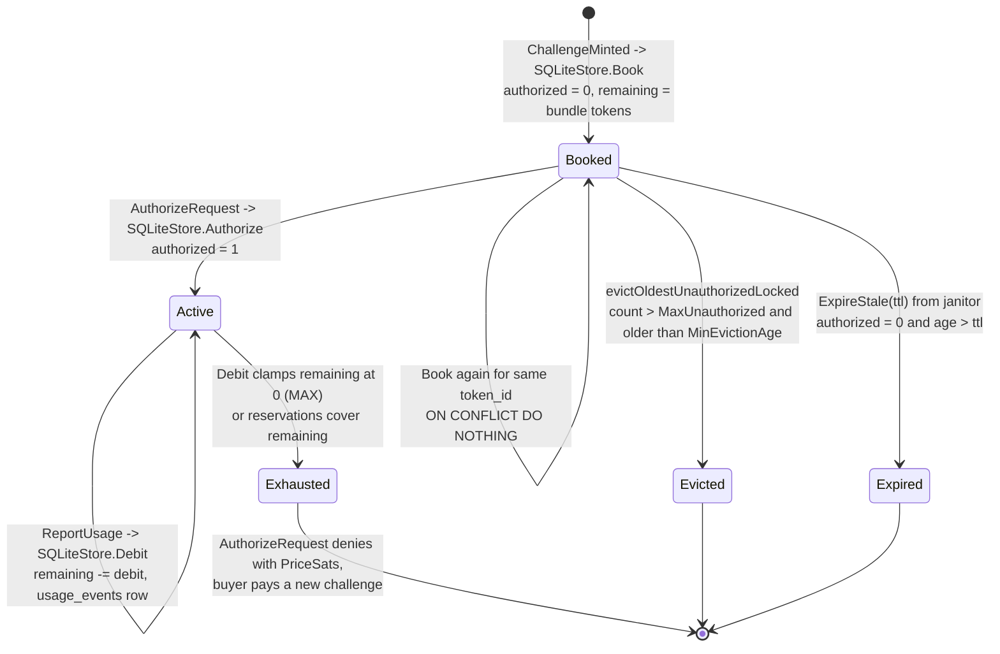
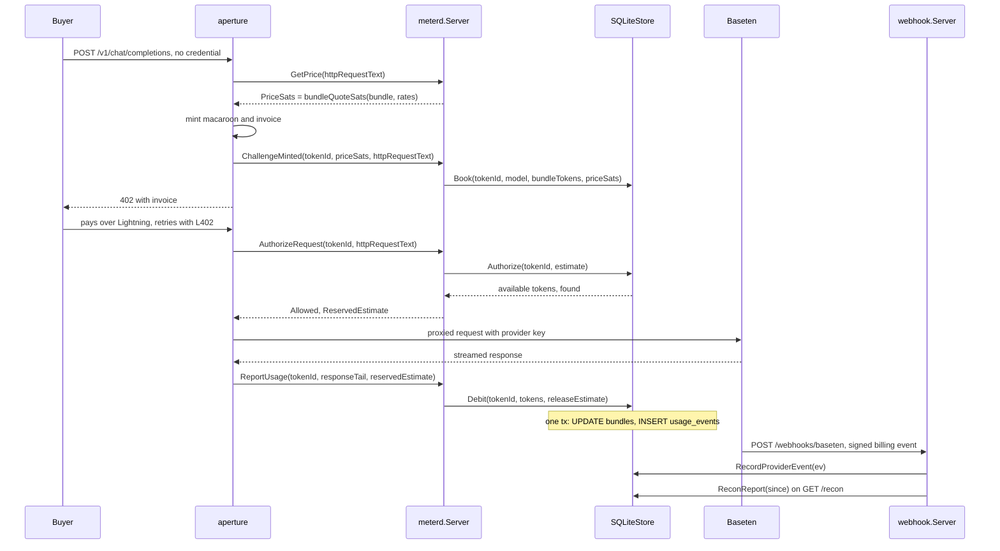
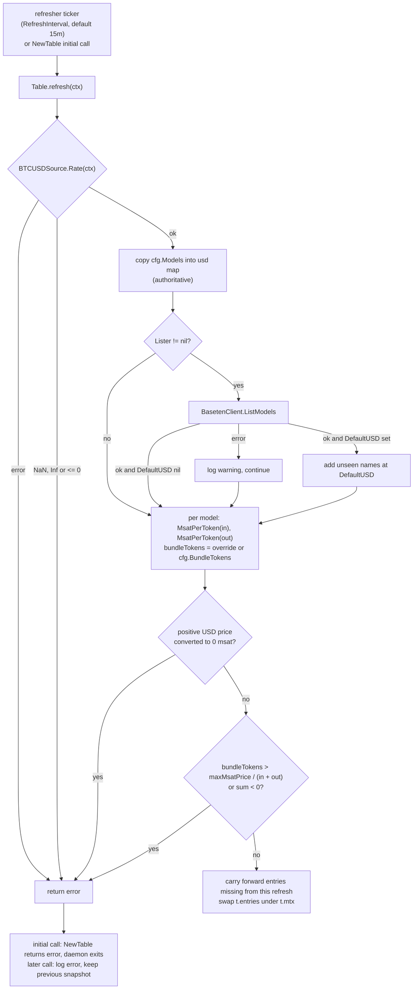
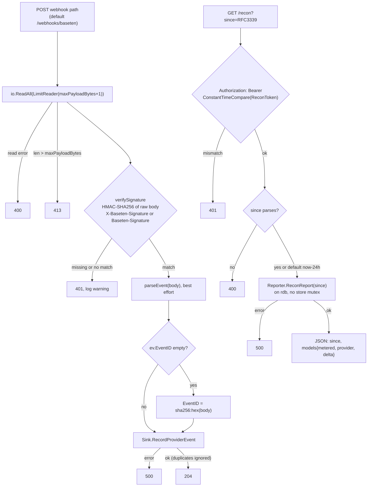
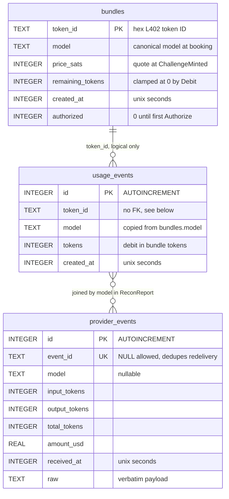

# lightmeter code architecture

This document maps the code of the lightmeter daemon: which type owns which
state, which goroutine touches it, and what happens message by message between
an aperture `pricesrpc` call and a durable row in sqlite. It was written against
commit `9e45710` and now covers `github.com/lightninglabs/aperture` v0.6.0.
The `meterd` and `pricesrpc` sources are identical between the commit the
statements were read from (`432fd60139b6`) and v0.6.0. For the system-level story across pi-402, aperture and lightmeter, read
[`architecture.md`](architecture.md); for the price formula and policy knobs,
[`pricing.md`](pricing.md); for deployment, [`operations.md`](operations.md).

The central fact is a split of responsibility inside one process.
`meterd.Server` (in aperture) implements the `pricesrpc.Prices` gRPC service and
the metering mechanics. Lightmeter supplies the two interfaces `meterd.Server`
is built around: `meterd.RateSource` (`pricing.Table`) and `meterd.Store`
(`store.SQLiteStore`). It also runs a webhook server that `meterd` knows
nothing about.

## Components

Four packages cooperate. `Daemon` (`lightmeter.go`) wires them, `meterd.Server`
calls into the table and the store on every RPC, and the webhook server writes
to and reads from the store on a separate listener.

The diagram shows two traffic classes. The money path is aperture to
`meterd.Server` to `pricing.Table` and `store.SQLiteStore`. The audit path is
Baseten to `webhook.Server` to `store.SQLiteStore`, which never touches the
table or `meterd.Server`.

| Component | Owns | Does not own |
| --- | --- | --- |
| `Daemon` (`lightmeter.go`) | Construction order, shutdown order, the `slog` logger. | Any business logic. |
| `meterd.Server` (aperture) | The `pricesrpc` handlers, bundle quote arithmetic (`bundleQuoteSats`), model and `max_tokens` extraction from the request text, usage extraction from the response tail, direction-weighted debit arithmetic, the janitor and flusher goroutines, the gRPC listener. | Prices, bundle sizes, persistence. It reaches both through `RateSource` and `Store`. |
| `pricing.Table` (`pricing/pricing.go`) | The msat-per-token snapshot (`entries`), the refresh goroutine, the validation that rejects a bad snapshot, model resolution and per-model bundle size. | Fetching rates (the `BTCUSDSource` and `ModelLister` interfaces), quote arithmetic, any balance. |
| `pricing.CoinbaseSpot`, `pricing.StaticBTCUSD` (`pricing/btcusd.go`) | One BTC-USD read per call. | Caching or retry; `Table` calls them once per refresh. |
| `pricing.BasetenClient` (`pricing/baseten.go`) | One `GET /v1/models` per call, returning model IDs. | USD prices. Baseten's listing is used only as a set of names. |
| `store.SQLiteStore` (`store/sqlite.go`) | `bundles`, `usage_events` and `provider_events` rows, the in-memory `reserved` map, eviction, retention, the reconciliation query. | Deciding whether to allow a request (`meterd.Server` does), pricing, payment. |
| `webhook.Server` (`webhook/webhook.go`) | Signature verification, best-effort payload parsing, the `/recon` bearer check, HTTP timeouts. | Storage (it calls `EventSink` and `Reporter`, both satisfied by `SQLiteStore`). |
| `Config` (`config.go`) | YAML and flag parsing, validation (`validate`), Baseten key resolution (`basetenAPIKey`). | Reloading: configuration is read once at start. |

## Startup and shutdown

`NewDaemon` builds the dependencies in the order the later ones need them, and
`Start` starts the goroutines in the same order. A failed construction step
releases what earlier steps opened.

Order matters in two places. The initial `Table.refresh` runs inside
`NewTable`, before the gRPC listener exists, so no RPC can reach an empty
table. On shutdown the webhook listener and the gRPC server stop before
`SQLiteStore.Close`, so no handler writes to a closed handle.

## The pricesrpc surface

`meterd.Server` registers four handlers that this document covers. Each one is
a thin composition of `RateSource` and `Store` calls. The source of every
statement below is `meterd/server.go` and `meterd/usage.go` at the pinned
aperture commit; lightmeter's side of each call is in the third column.

| RPC | When aperture calls it | `RateSource` calls | `Store` calls | Result |
| --- | --- | --- | --- | --- |
| `GetPrice` | A request arrives with no credential and aperture needs a quote for the 402 challenge. | `ResolveModel`, `BundleTokens` | none | `PriceSats` for a full bundle. `InvalidArgument` when the model is unknown or unreadable. |
| `ChallengeMinted` | Aperture minted a challenge for the quoted price. | `ResolveModel`, `BundleTokens` | `Book(tokenID, model, tokens, priceSats)` | Empty response. `Book` is idempotent per token ID. |
| `AuthorizeRequest` | A request carries a valid L402 credential. | `ResolveModel` (model guard, denial quote), `BundleTokens` | `Get`, `Authorize(tokenID, estimate)` | `Allowed` with `ReservedEstimate`, or a denial with `PriceSats` and `Reason`. |
| `ReportUsage` | The response finished, or the stream was cut. | `ResolveModel` (booked model's rates) | `Get`, `Debit(tokenID, tokens, release)` | `DebitedSats`, `RemainingSats`. |

`QuoteSession` and `SettleSession` (`meterd/session.go`) are also served by the
same `meterd.Server` for aperture's session payment scheme. They book nothing
in the store and are outside this document.

The decision inside `AuthorizeRequest` is the only multi-branch handler, so it
gets its own diagram.

Three properties follow from the diagram. Unknown models fail closed in both
`GetPrice` and the guard, so a cheap bundle cannot be spent on a model the
table prices higher. A denial carries `PriceSats` computed from the table, so
aperture can mint the next challenge without a `GetPrice` round trip;
`PriceSats` stays zero when no rate resolves, and aperture then calls
`GetPrice`. Denials are responses, not gRPC errors; errors are reserved for
unreadable models and internal failures.

`Store.Authorize` runs for every request that reaches it, including ones that
will be denied: it sets `authorized = 1` on the first call for a token. Because
aperture only calls `AuthorizeRequest` for a credential whose preimage has been
verified, `authorized = 1` is the store's record that the invoice was paid.

## Bundle lifecycle: quote, debit, reconciliation

One Lightning payment buys one bundle of N tokens. N is `BundleTokens` of the
model (the per-model override when positive, otherwise `Config.BundleTokens`,
default `DefaultBundleTokens` = 1,000,000). A bundle row moves through three
states, and the rows it leaves behind outlive it.

`Active` and `Exhausted` bundle rows are never deleted: only rows with
`authorized = 0` are eligible for eviction and expiry, and the retention sweep
touches only the event tables. A bundle that is used once is therefore kept
indefinitely, with `remaining_tokens` at zero when spent. `Exhausted` is not a
stored value: it is the condition `remaining_tokens - reservations <= 0`
evaluated in `Authorize`.

The whole path, from the first request to the reconciliation report, crosses
four processes. Lightmeter is only a callee until the final `GET /recon`.

The numbered steps below name the function that performs each one.

1. **Quote.** `meterd.Server.GetPrice` resolves the model through
   `Table.ResolveModel` and returns `ceil(bundleTokens * (inMsat + outMsat) / 2 / 1000)`
   sats, computed by `bundleQuoteSats`. The bundle is priced at the blended
   per-token rate.
2. **Book.** `ChallengeMinted` calls `SQLiteStore.Book`, which inserts the
   `bundles` row with `authorized = 0` and `remaining_tokens` set to the bundle
   size. If the count of rows with `authorized = 0` then exceeds
   `MaxUnauthorized` (default `DefaultMaxUnauthorizedBundles` = 10,000),
   `evictOldestUnauthorizedLocked` deletes the oldest excess rows older than
   `MinEvictionAge`, which `NewDaemon` sets to `UnauthorizedBundleTTL` or
   `meterd.DefaultUnauthorizedBundleTTL` (10 minutes). Rows younger than the
   floor count toward the cap but are never evicted, so a mint burst cannot
   remove a bundle that was just paid.
3. **Authorize and reserve.** `SQLiteStore.Authorize` reads the row, computes
   `available = remaining - reservedLocked(tokenId)`, sets `authorized = 1`,
   and appends a `reservation` of `estimate` tokens to the in-memory
   `reserved` map when `available > 0`. The estimate is the request's
   `max_tokens` when present, otherwise `DefaultEstimatedTokens` = 4,096.
   Reservations bound concurrent overdraw of a near-empty bundle.
4. **Report and debit.** `ReportUsage` parses the usage object from the
   captured tail. With a prompt/completion split the debit is
   `ceil(2 * (prompt*inMsat + completion*outMsat) / (inMsat + outMsat))` bundle
   tokens; without a split it is the total count; an incomplete successful
   response with bytes but no usage object settles at the reserved estimate.
   `SQLiteStore.Debit` then releases the reservation, and in one transaction
   subtracts the debit (clamped at zero) and appends a `usage_events` row.
5. **Ingest.** Independently, Baseten posts billing events to
   `webhook.Server.handleWebhook`, which stores them in `provider_events`.
6. **Reconcile.** `GET /recon` calls `SQLiteStore.ReconReport`, which sums
   `usage_events.tokens` and `provider_events` tokens per model since a
   timestamp and reports the difference.

### Reservations

`reserved` (`map[string][]reservation`) is memory-only and guarded by the store
mutex. It is not persisted, so a restart drops every in-flight reservation by
design. `pricesrpc` does not correlate a usage report with the authorization
that preceded it by anything but the echoed `ReservedEstimate`, so
`releaseLocked` releases up to that amount from the oldest entries first.
Entries older than `maxReservationAge` (10 minutes) are discarded in
`reservedLocked`, which is also called for every token by `ExpireStale`.
`Debit` releases before it opens the transaction, so a failed transaction
still releases the reservation.

## Pricing pipeline

`pricing.Table` converts USD to msat. Everything the RPCs quote derives from
one snapshot map, `Table.entries`, replaced wholesale on each successful
refresh.

The two consequences of the diagram are asymmetric failure and monotonic
catalogs. A failed first refresh stops the daemon from starting; a failed later
refresh logs `Rate table refresh failed, keeping the previous snapshot` and the
old `entries` keep serving. A model that disappears from a refresh keeps its
last entry (`Model vanished from refresh, keeping last-known rates`), so a
paid bundle booked against it does not become unspendable behind the model
guard. Configured models are always in the new snapshot, and discovery never
overrides them.

`MsatPerToken(usdPerMTok, marginPercent, btcUSD)` computes
`usdPerMTok * 100_000 * (1 + marginPercent/100) / btcUSD`, rounds up with
`math.Ceil`, and floors any positive result at 1 msat. It returns 0 for NaN,
infinities, non-positive inputs and results at or beyond `math.MaxInt64`;
`refresh` treats 0 for a positive USD price as a failure, not as free. The
overflow guard uses `maxMsatPrice = 1 << 60`, mirroring the same constant in
`meterd`. `Config.validate` additionally bounds a configured margin at
`maxMarginPercent` = 10,000 and a configured USD rate at `maxUSDPerMTok` =
1,000,000.

`ResolveModel` returns the table entry for a non-empty identifier or an error;
only an empty identifier falls back to `DefaultModel`. `BundleTokens(model)`
returns the entry's size, or `cfg.BundleTokens` for a name the table does not
hold. The BTC-USD source is `StaticBTCUSD` when `Pricing.BTCUSD.StaticRate` is
positive and `CoinbaseSpot` otherwise; its HTTP client timeout is 10 seconds,
and `BasetenClient`'s is 15 seconds. `Daemon` constructs `BasetenClient` only
when `basetenAPIKey` returns a non-empty key.

## Reconciliation pipeline

Reconciliation compares two independent ledgers per model: tokens debited from
bundles (`usage_events`) and tokens the provider says it billed
(`provider_events`). A persistently negative `delta_tokens` means the provider
billed usage that was never debited.

Four rules sit under the diagram. The payload is stored verbatim in
`provider_events.raw` whether or not `parseEvent` extracted anything. The
signature header may hold several comma-separated values, each optionally
prefixed `v1=`, and any one matching is accepted. `RecordProviderEvent`
deduplicates on the `event_id` unique key; a NULL `event_id` is never
deduplicated, which is why `handleWebhook` always supplies a hash-derived ID.
`GET /recon` is registered only when both a `Reporter` and a non-empty
`ReconToken` are configured; the webhook server itself requires a non-empty
`Secret`.

`ReconReport` runs two grouped queries on the read-only handle `rdb` and
merges them by model. The provider total per event is
`MAX(total_tokens, input_tokens + output_tokens)`. A provider event with no
model is grouped under the empty string, and appears as its own row with zero
`metered_tokens`.

## Storage

All durable state is one sqlite file (`Config.DBPath`, driver
`modernc.org/sqlite`). There is no second backend; the only other copy of
state is the `reserved` map.

| Aspect | Value |
| --- | --- |
| Writer handle `db` | `SetMaxOpenConns(1)`; pragmas `journal_mode = WAL`, `synchronous = NORMAL`, `busy_timeout = 5000`. |
| Reader handle `rdb` | `SetMaxOpenConns(1)`; pragma `busy_timeout = 5000` only. Used by `ReconReport`. |
| Schema | `schema` constant, idempotent `CREATE ... IF NOT EXISTS`, applied on every start. No versioned migrations. |
| Pruning | `usage_events` and `provider_events` older than `Retention` (`RetentionDays` x 24h, default 90 days), at most once per hour, from `ExpireStale`. `bundles` is never pruned for authorized rows. |

Both relationships in the diagram are logical, not enforced. `usage_events`
has no foreign key to `bundles` because the ledger must outlive bundle rows
(`ExpireStale` and count eviction delete unauthorized bundles) and because
retention prunes the two tables on different schedules. `usage_events.model`
is copied from the bundle at debit time so reconciliation does not need the
bundle row. `provider_events` has no relation to a bundle at all: Baseten
bills the seller's key, not an L402 token, so the only shared key is `model`.
Indexes: `bundles_unauthorized_idx` on `(authorized, created_at)` serves
eviction and expiry; `usage_events_created_idx` on `created_at` serves
retention and the report window. `provider_events` has no `received_at` index.

Transactions are used once. `SQLiteStore.Debit` wraps the balance update and
the ledger insert in a single transaction, so a crash cannot debit a bundle
without its ledger row. Every other write is a single statement. All methods of
the `meterd.Store` interface and `RecordProviderEvent` serialize on
`SQLiteStore.mtx`; the writer handle has one connection in any case.

## Concurrency

`Daemon` starts five long-lived goroutines, plus the per-call goroutines of the
two servers.

| Goroutine | Started by | Touches | Stops on |
| --- | --- | --- | --- |
| gRPC `Serve` | `meterd.Server.Start` | Spawns one handler goroutine per RPC; handlers call `Table` (read lock) and `SQLiteStore` (store mutex). | `GracefulStop` in `meterd.Server.Stop`. |
| `meterd.Server.janitor` | `meterd.Server.Start` | `SQLiteStore.ExpireStale(ttl)` every `janitorInterval` (1 minute). | `quit` channel. |
| `meterd.Server.flusher` | `meterd.Server.Start` | `SQLiteStore.Flush` every `flushInterval` (5 seconds); a no-op for sqlite. | `quit` channel. |
| `Table.refresher` | `Table.Start`, only when `RefreshInterval > 0` | Calls `refresh` with a 1 minute context; takes `Table.mtx` for write at the swap. | `Table.quit` channel, then `wg.Wait`. |
| webhook `ListenAndServe` | `webhook.Server.Start` | Spawns one handler goroutine per HTTP request; `handleWebhook` writes via `RecordProviderEvent` (store mutex), `handleRecon` reads via `rdb` (no store mutex). | `srv.Close` in `webhook.Server.Stop`. |

| State | Owner and guard |
| --- | --- |
| `Table.entries` | `Table.mtx` (`sync.RWMutex`); readers `ResolveModel` and `BundleTokens`, the single writer is `refresh`. |
| `SQLiteStore.reserved`, `lastPrune` | `SQLiteStore.mtx`. |
| `bundles`, `usage_events`, `provider_events` rows | The single-connection writer `db`; metering writes also hold `SQLiteStore.mtx`. |
| `rdb` | Read-only queries from `ReconReport`; WAL lets them run while the writer commits. |
| Config | Immutable after `LoadConfig`. |

Rules that the table does not show:

- **Timers run in their own goroutines.** The refresher and janitor tickers do
  their work outside any RPC handler. A slow
  Coinbase or Baseten call delays the next refresh, not a quote, because
  handlers read the last snapshot under the read lock.
- **The webhook path contends with metering.** `RecordProviderEvent` and
  `ExpireStale` (which includes the retention `DELETE`s) take the same
  `SQLiteStore.mtx` as `Authorize` and `Debit`. A retention sweep over a large
  event table therefore holds the metering path. `ReconReport` is the exception
  by design.
- **`ReportUsage` is not one atomic step.** It calls `Store.Get` for the
  booked model's rates and then `Store.Debit`; the two acquire the mutex
  separately. A bundle deleted between them returns a zero response and the
  usage report is unbilled, but only unauthorized bundles are deleted and a
  reported bundle was authorized.
- **A caller-side timeout does not mean the handler did not run.** `Debit` can
  commit after the caller gave up, and the store has no idempotency key for a
  usage report, so a repeated `ReportUsage` debits again.
- **Shutdown order is webhook, `meterd.Server`, `Table`, then store.**
  `meterd.Server.Stop` calls `Store.Flush` last, after its workers have exited.

## Boundaries: what lightmeter does not own

- **The aperture proxy.** Lightmeter does not mint macaroons or invoices,
  verify credentials, decide to proxy, capture the response tail, or retry. It
  answers four questions and trusts the caller completely, which is why
  `validate` refuses a plaintext gRPC listener on a non-loopback address.
- **The wallet and lnd.** No Lightning dependency exists in this repository.
  Payment is observable only through the first `AuthorizeRequest` for a token,
  and the invoice amount is whatever `ChallengeMinted` reports as `PriceSats`.
  Lightmeter never sees preimages, channel state or settled amounts.
- **The upstream provider.** Lightmeter calls Baseten for `GET /v1/models`
  only, never for inference, and holds no inference key; the proxy attaches it.
  Baseten's USD prices come from the config, not from the API. Baseten calls
  lightmeter only through the signed billing webhook.
- **The metering mechanics.** Quote arithmetic, usage extraction and debit
  weighting live in `meterd`; a change to them is an aperture change plus a
  `go.mod` bump here.

## Known gaps

- The `meterd` behavior described comes from reading aperture commit
  `432fd60139b6`, not from running it. `meterd` and `pricesrpc` did not change
  between that commit and v0.6.0. Where the dependency moves again, the RPC
  tables and the `AuthorizeRequest` diagram need a re-check.
- The `QuoteSession` and `SettleSession` RPCs are named but not mapped.
- The Baseten webhook payload shape is not documented in this repository.
  `parseEvent` accepts several key spellings, and which ones Baseten actually
  sends was not confirmed.
- Behavior under a crash between `Authorize` and `ReportUsage` follows from the
  code (reservations vanish, the bundle row survives) and was not exercised.
